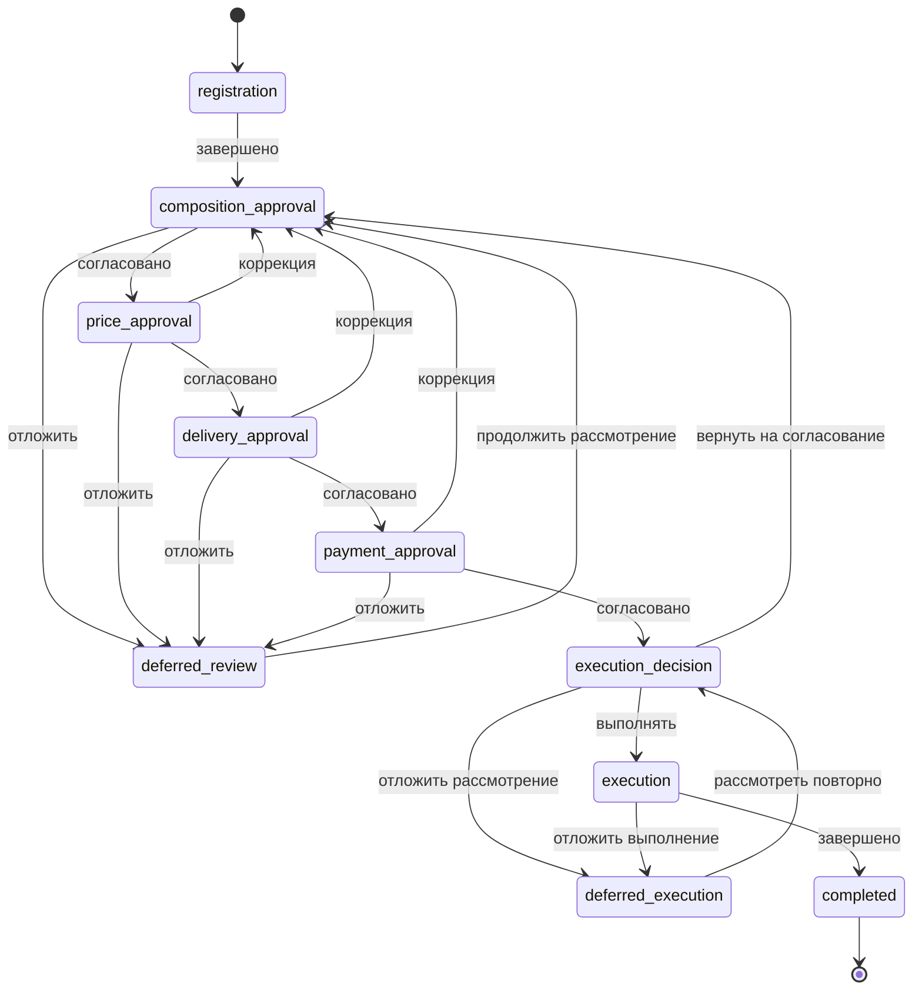
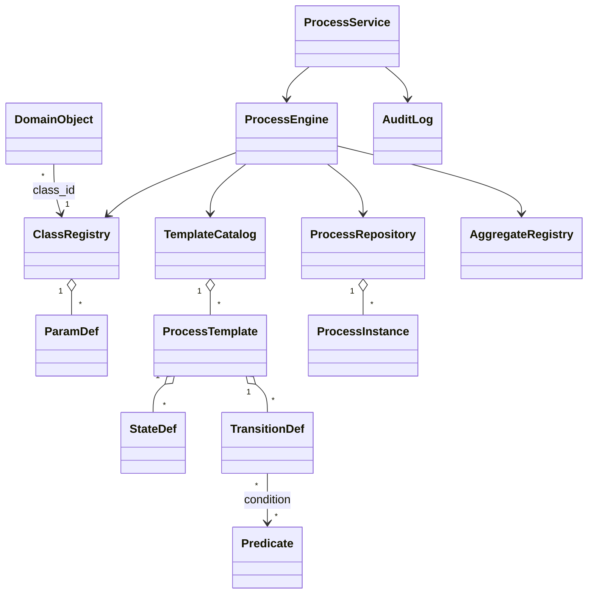

# Управление заказом на поставку стандартной продукции

Реализация задания 3-1-1 «Приёмы моделирования бизнес-логики», вариант 3.
Система исполняет бизнес-процесс над заранее описанными объектами предметной
области. Классы, параметры, объекты, пользователи, роли и шаблон процесса
задаются в YAML; общий исполнитель не содержит названий состояний, действий и
правил конкретного варианта.

## Требования

- Python 3.12+
- PyYAML
- pytest для запуска тестов

Зависимости зафиксированы в `requirements.txt`. Рекомендуется виртуальное
окружение:

Windows (PowerShell):

```powershell
python -m venv .venv
.\.venv\Scripts\Activate.ps1
python -m pip install -r requirements.txt
```

Linux/macOS:

```bash
python3 -m venv .venv
. .venv/bin/activate
python -m pip install -r requirements.txt
```

Если активация окружения не нужна, можно вызывать интерпретатор напрямую:
`.\.venv\Scripts\python.exe -m ...` (Windows) или `.venv/bin/python -m ...`
(Linux/macOS).

## Быстрый запуск

Интерактивная консоль:

```bash
python -m app --config config/purchase_order.yaml --journal var/journal.jsonl
```

Сценарий из файла:

```bash
python -m app \
  --config config/purchase_order.yaml \
  --journal var/journal.jsonl \
  --script commands/demo.txt
```

Демонстрация отказов и возвратов:

```bash
python -m app \
  --config config/purchase_order.yaml \
  --journal var/journal.jsonl \
  --script commands/refusals.txt
```

Демонстрация отложенных веток и возврата из решения о выполнении:

```bash
python -m app \
  --config config/purchase_order.yaml \
  --journal var/journal.jsonl \
  --script commands/deferred.txt
```

Журнал дописывается в конец файла. Для чистого прогона используйте новый путь
или удалите старый журнал.

## Интерактивная консоль

После запуска программа загружает конфигурацию, создаёт объекты и шаблон, но не
запускает процессы. Доступны команды:

```text
start <пользователь> <объект>
action <пользователь> <объект> <действие>
state <объект>
objects
users
processes
help
quit
```

Пример:

```text
> start ivanov order-main
accepted: — -> registration

> action ivanov order-main submit
accepted: registration -> composition_approval

> action petrov order-main approve
accepted: composition_approval -> price_approval

> action petrov order-main approve
rejected: В состоянии 'price_approval' требуется одна из ролей: pricing_department

> quit
```

Команды `start` и `action` можно вводить и в JSON-формате:

```json
{"type":"start","user":"ivanov","object":"order-main"}
{"type":"action","user":"petrov","object":"order-main","action":"approve"}
```

Формат ввода выбирается параметром `--format auto|text|json`. По умолчанию
`auto`: строка, начинающаяся с `{`, разбирается как JSON, остальные — как
текстовая команда.

## Предметная модель

Классы:

- `purchase_order` — базовый заказ: `priority` (`string`), `total_amount`
  (`decimal`), `delivery_days` (`integer`), `payment_terms` (`string`);
- `order_item` — позиция заказа: `product_code` (`string`), `quantity`
  (`integer`), `unit_price` (`decimal`);
- `standard_order` — наследует `purchase_order`, переопределяет
  `delivery_days` диапазоном 1–30 и значением по умолчанию 14, добавляет
  состав `items` из объектов `order_item`.

Поддерживаются типы параметров `integer`, `decimal`, `string` и состав.
Для числовых типов задаются необязательные границы `min`/`max` и `default`;
целочисленные параметры не принимают дробных значений. Полная валидация
произвольной конфигурации не требуется, но типы проверяются при загрузке.

Реализованы оба механизма объектной модели:

- **наследование параметров** — `standard_order` наследует параметры
  `purchase_order`; переопределённое описание `delivery_days` заменяет
  родительское целиком, тип сохраняется;
- **составность** — `standard_order.items` хранит ссылки на заранее
  загруженные объекты `order_item`; количество проверяется предикатом с
  агрегатором `all`.

Незаданный состав и явный `null` для состава нормализуются в пустой список.
Для скалярных параметров явный `null` остаётся незаданным значением и не
заменяется на `default`.

Готовые объекты описаны в `config/purchase_order.yaml`. Например,
`order-main` проходит основной маршрут, `order-empty-items` и
`order-bad-items` дают отказ по условию состава, `order-long-delivery`
проверяет переопределённый диапазон срока поставки, `order-express`
проверяет второй дизъюнкт условия цены.

## Шаблон процесса

Шаблон `purchase_order_process` привязан к классу `standard_order`. Состояния:
`registration`, `composition_approval`, `price_approval`, `delivery_approval`,
`payment_approval`, `deferred_review`, `execution_decision`, `execution`,
`deferred_execution`, `completed`. Начальное состояние — `registration`,
конечное — `completed`. Роли состояний перечислены в
`config/purchase_order.yaml`: продажи, согласование состава, цены, поставки,
оплаты, рассмотрение отложенных заказов и исполнение.

Диаграмма состояний соответствует рис. 3 задания:



Действия:

- `submit` — регистрация → согласование состава;
- `approve` — согласование текущего этапа;
- `correct` — возврат на согласование состава из согласований цены, поставки
  и оплаты;
- `defer` — отложить рассмотрение из любого этапа согласования либо отложить
  выполнение из решения о выполнении и из самого выполнения;
- `resume` — продолжить рассмотрение: из `deferred_review` обратно в
  `composition_approval`;
- `return` — вернуть на согласование состава из решения о выполнении;
- `execute` — принять заказ к выполнению;
- `reconsider` — рассмотреть повторно: из `deferred_execution` обратно в
  `execution_decision`;
- `complete` — завершить выполнение.

Условия заданы в ДНФ. Например, условие согласования цены:

```text
(amount_ok И prepayment_ok) ИЛИ
(amount_ok И НЕ prepayment_ok И express)
```

Условие состава:

```text
has_items И items_quantity_ok
```

где `items_quantity_ok` проверяет `items.quantity` оператором `in_range` с
агрегатором `all`.

## Обработка команд

Каждая команда проходит один путь:

```text
файл или stdin
  -> CLI
  -> ProcessService.handle
  -> ProcessEngine.start / act
  -> проверки пользователя, объекта, шаблона, процесса, роли и условий
  -> CommandResult
  -> AuditLog (одна запись)
  -> консоль
```

Порядок проверки действия:

1. пользователь существует;
2. объект существует;
3. процесс запущен;
4. для класса объекта есть шаблон;
5. состояние процесса описано в шаблоне;
6. состояние не конечное;
7. существует переход по паре «состояние, действие»;
8. у пользователя есть роль текущего состояния;
9. условие перехода истинно;
10. подходит ровно один переход.

Если подходит несколько переходов, возвращается ошибка неоднозначности, а
состояние не меняется. При отказе или ошибке состояние также не меняется.
Непредвиденное исключение при выполнении команды перехватывается, попадает в
журнал с кодом `internal_error`, состояние процесса остаётся прежним.

## Устройство программы

Основные классы:



Архитектурные решения:

- **Type Object.** `ClassRegistry` и `ParamDef` описывают классы и параметры
  данными, а `DomainObject` хранит только класс и значения.
- **Табличный автомат.** `ProcessTemplate.by_key` индексирует переходы по паре
  «состояние, действие»; `ProcessEngine` не содержит имён конкретного
  варианта и одинаково исполняет любой шаблон из конфигурации.
- **Interpreter.** `compile_condition` строит дерево `Or(And(...))` с `Not`;
  строки конфигурации не исполняются как код.
- **Strategy.** `AggregateRegistry` — словарь «имя → функция»; выбранный
  агрегатор (`all` или `any`) подставляется по полю `aggregate`.
- **Внедрение зависимости.** `ProcessService` получает `AuditLog` извне:
  в CLI используется JSONL-журнал, в тестах — журнал в памяти.

Раздел 5 задания назван рекомендацией, поэтому вместо буквального набора
классов `Command`, `StateMachine`, `Context`, `InterpreterClient` их роли
выполняют `ProcessService`, `ProcessTemplate`/`ProcessEngine`, `EvalContext` и
`compile_condition`.

## Журнал

Журнал ведётся в JSONL: один JSON-объект на строку. Записываются успех,
отказ и ошибка, включая некорректные команды. Пример записи:

```json
{
  "command": {"type": "action", "user": "petrov", "object": "order-main", "action": "approve"},
  "user": "petrov",
  "object": "order-main",
  "state_before": "composition_approval",
  "state_after": "composition_approval",
  "result": "rejected",
  "reason": "Условие перехода не выполнено",
  "reason_code": "condition_not_met"
}
```

Поля `state_before` и `state_after` при отказе совпадают. Для успешного запуска
`state_before` равен `null`. При вводе из консоли или файла дополнительно
сохраняется поле `raw` с исходной строкой команды. Журнал не используется для
восстановления процессов: после перезапуска объекты загружаются заново, а
запущенных процессов нет.

## Тесты

После активации виртуального окружения:

```bash
python -m pytest -q
```

В Windows без активации:

```powershell
.\.venv\Scripts\python.exe -m pytest -q
```

Тесты проверяют:

- основной маршрут до `completed`;
- возврат `correct` на согласование состава;
- возврат `return` из решения о выполнении;
- отказ по роли при запуске и при действии, неизменность состояния;
- отказ по условию для пустого состава и позиции вне диапазона;
- агрегатор `all` и различие `all`/`any`;
- наследование и переопределение `delivery_days`;
- типы `integer` и `decimal`, отказ при неверном типе значения;
- значения по умолчанию, явный `null` и пустой/отсутствующий состав;
- повторный запуск и действие в конечном состоянии;
- отложенное рассмотрение из каждого этапа согласования и возврат `resume`;
- отложенное выполнение и возврат `reconsider` в решение о выполнении;
- экспресс-заказ с постоплатой и превышение суммы;
- неоднозначный переход и неподдерживаемый агрегатор;
- записи журнала в памяти и в JSONL-файле, включая отказ;
- непредвиденное исключение: запись `internal_error` и неизменность состояния;
- некорректные команды и разбор JSON.

## Структура проекта

```text
app/
  __main__.py        запуск python -m app
  cli.py             интерактивная консоль и режим сценария
  config_loader.py   загрузка YAML и сборка компонентов
  classes.py         реестр классов и наследование
  objects.py         загрузка объектов и составов
  predicates.py      предикаты и агрегаторы
  expressions.py     дерево ДНФ
  templates.py       шаблоны процессов
  engine.py          табличный автомат и экземпляры процессов
  service.py         единая точка обработки команд
  journal.py         JSONL-журнал и журнал в памяти
config/
  purchase_order.yaml
commands/
  demo.txt
  refusals.txt
  deferred.txt
tests/
```

## Ограничения

- нет графического интерфейса (будет добавлен), аутентификации и проверки пароля;
- нет СУБД, очереди и восстановления процессов из журнала;
- рабочие состояния хранятся только в памяти;
- в конфигурации используется один шаблон процесса; код поддерживает несколько
  шаблонов — не более одного на класс;
- составность поддерживает один уровень вложенности;
- полная валидация произвольной конфигурации не выполняется, но критичные
  ошибки (неизвестный агрегатор, дубли шаблонов, отсутствие начального
  состояния, неизвестные ссылки) обнаруживаются при загрузке.
